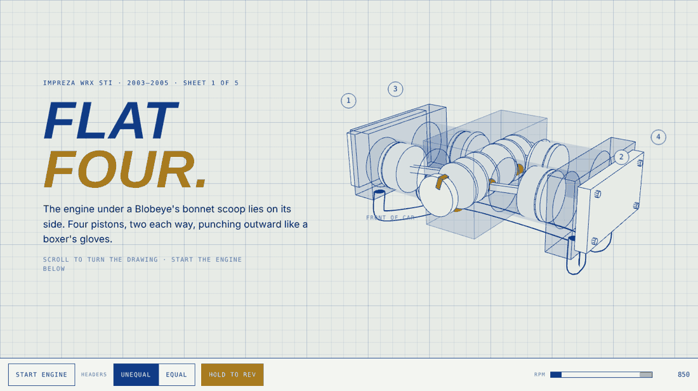
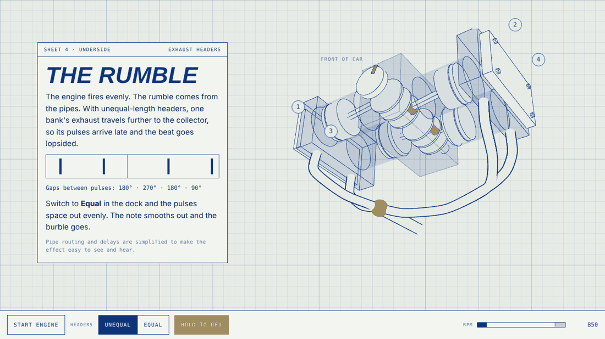

# Blobeye

An interactive tribute to the Subaru Impreza WRX STI, drawn as a blueprint you can scroll through.
The first chapter is the flat-four engine: turn it, rev it, and hear why it rumbles.



> Unofficial fan project. Not affiliated with or endorsed by Subaru Corporation.

## What it does

- **Scroll turns the drawing.** Five sheets, five camera angles: three-quarter, plan, front, underside, and one to play with.
- **The firing order plays live.** Cylinders flash 1-3-2-4 and exhaust pulses travel down the pipes to the collector.
- **Hold to rev.** The exhaust note is generated in the browser from the same model that drives the drawing.
- **Unequal or equal headers.** Switch them and watch the pulses bunch up or even out, and hear the beat change.



## Run it

Needs [Node.js](https://nodejs.org) 20 or newer.

```bash
npm install
npm run dev
```

Then open the address it prints (usually http://localhost:5173).

| Command | What it does |
| --- | --- |
| `npm run dev` | Start the dev server with live reload |
| `npm test` | Run the unit tests |
| `npm run build` | Typecheck and build to `dist/` |
| `npm run preview` | Serve the built site locally |

## How it is built

| Part | Where | Notes |
| --- | --- | --- |
| Engine model | `src/engine/model.ts` | Pure functions: firing order, pulse timing, piston geometry, revs. No DOM, fully tested. |
| Drawing | `src/scene/` | Three.js. Paper-coloured faces with ink edges, no lighting. Camera blends between one keyframe per sheet. |
| Sound | `src/audio/exhaust.ts` | Web Audio. Each pulse reaching the collector triggers a short thump. |
| Controls and readouts | `src/ui/` | Plain DOM. |
| Page and styles | `index.html`, `src/styles.css` | Light and dark themes from CSS variables, which the 3D scene also reads. |

The drawing and the sound both read from the same model, so what you see and what you hear cannot drift apart.

Stack: Vite, TypeScript, Three.js, Vitest. No UI framework: the page is one canvas and a few panels.

## Roadmap

See [docs/ROADMAP.md](docs/ROADMAP.md). In short: finish the engine chapter, put the car around it, tell the rally story, add a Safari Rally mini-game, launch.

## Accuracy

Car facts are tracked in [docs/FACTS.md](docs/FACTS.md) with sources. Pipe routing, timing and proportions are simplified to make the idea clear, and the page says so.

## Licence

Code is MIT licensed. See [LICENSE](LICENSE). Subaru, Impreza, WRX and STI are trademarks of Subaru Corporation.
