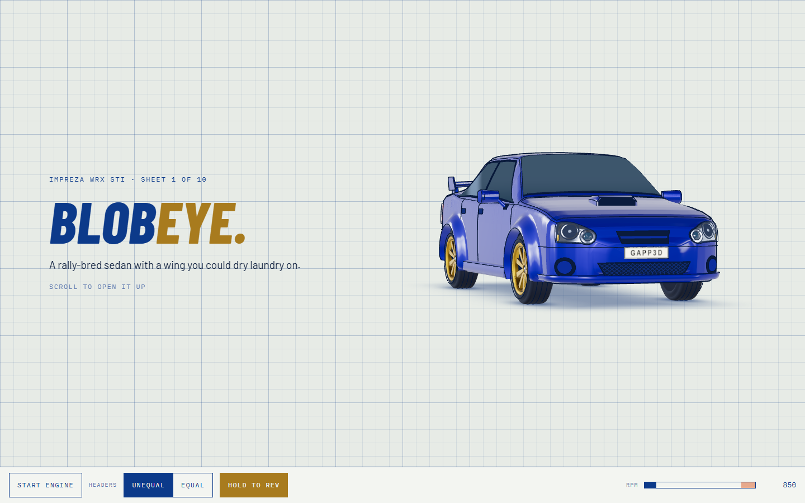
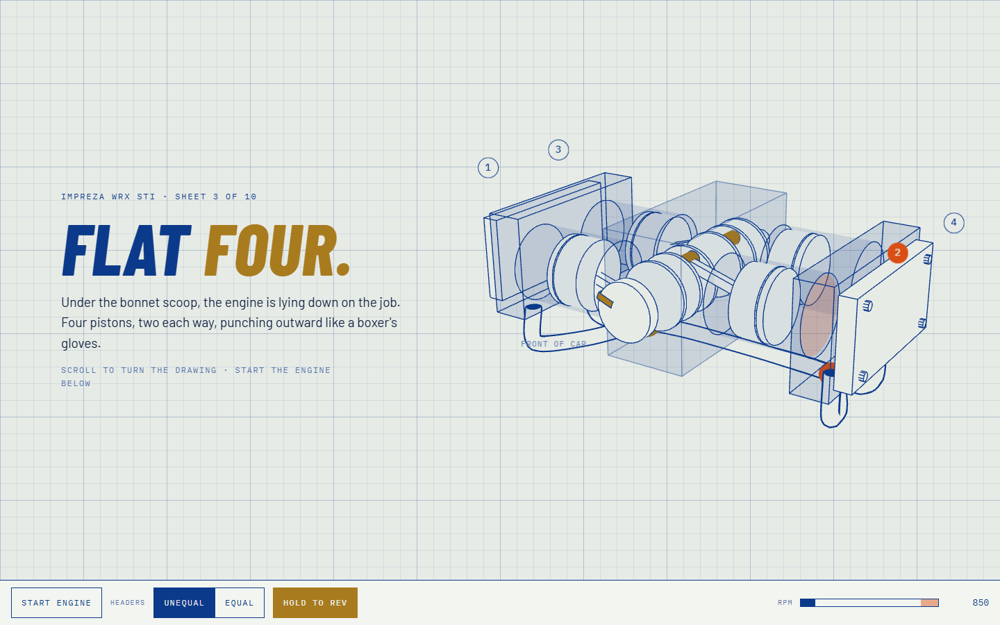
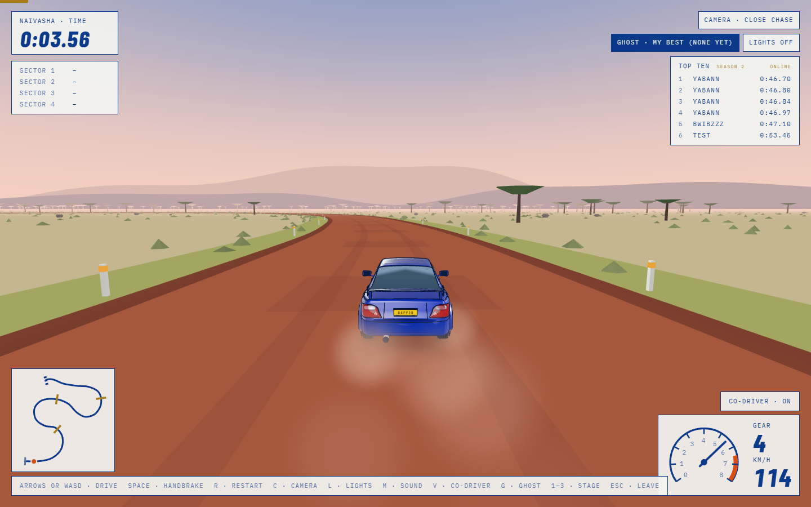
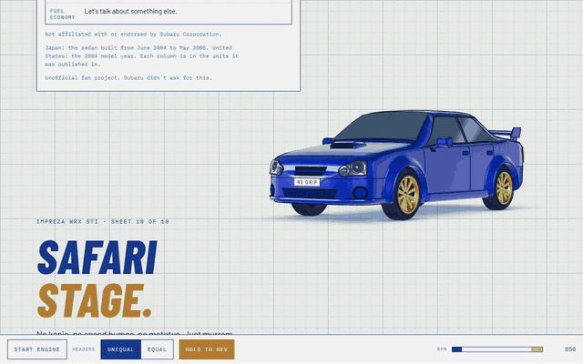

# Blobeye

**Live: [blobeye.vercel.app](https://blobeye.vercel.app)**

An interactive tribute to the Subaru Impreza WRX STI, drawn as a blueprint you can scroll through.
Open up the car, turn the flat-four engine, rev it and hear why it rumbles, then drive it on a Safari Rally stage.



> Unofficial fan project. Not affiliated with or endorsed by Subaru Corporation.

## What it does

Ten sheets, on a laptop or a phone.

- **The car.** A 3D model of the 2004 STI on the blueprint, and an X-ray sheet that peels the paint away to show the drivetrain.
- **Scroll turns the drawing.** The engine chapter has five sheets and five camera angles: three-quarter, plan, front, underside, and one to play with.
- **The firing order plays live.** Cylinders flash 1-3-2-4 and exhaust pulses travel down the pipes to the collector.
- **Hold to rev.** The exhaust note is generated in the browser from the same model that drives the drawing.
- **Unequal or equal headers.** Switch them and watch the pulses bunch up or even out, and hear the beat change.
- **The rally years.** A timeline of Subaru's world rally titles and Safari Rally wins, every entry sourced in `docs/FACTS.md`.
- **The numbers.** The 2004 car's Japanese and United States specs side by side.
- **Drive it.** On the last sheet the car drives off the blueprint into a 3D gravel time trial. Three stages of about a minute each: Naivasha, Hell's Gate and Roysambu. Along the way there are fords, crests, bridges, a hairpin and animals on the road. You get a co-driver who calls the pace notes, split times, medals, a ghost of your best run, four cameras, and day or night runs. Each stage has a top ten shared by everyone who drives it.
- **On a phone too.** Every sheet works upright on a phone. To drive, turn the phone sideways. You steer with an on-screen wheel, by tilting the phone, or with two arrow pads, and there are pedals and an optional handbrake.







## How it was built

- **A traced model.** The car's body is numbers, not a downloaded mesh. Its outlines (the roof line, the sills, the window line, the width along its length, the wheel arches) were traced point by point from two reference drawings, a side view and a top view. They are kept as curves in car units (the car is 100 long). `src/car/model.ts` reads them, and the scene builds the body from them. The tests check the traced points and the shape between them.
- **One engine model behind the drawing and the sound.** `src/engine/model.ts` holds the firing order, the piston positions, the header delays and the revs as pure functions. The drawing uses it to move the pistons and send pulses down the pipes. The sound uses it to play a thump each time a pulse reaches the collector. Because both read the same numbers, what you see and what you hear stay in step, and switching the headers changes both at once.
- **A live leaderboard.** Each stage's top ten is a Supabase table, `rally_times`, read and written over its REST API with the publishable key. The key may only read and insert. The database checks every row: the name, a possible time, and a replay whose length fits that time. The fastest run that has a replay comes back as the stage-record ghost. When the board can't be reached, the game falls back to times kept on the device. Names are checked against a small blocklist before they are sent. A GitHub Actions job reads one row a day so the free project doesn't pause.

## Run it

Needs [Node.js](https://nodejs.org) 20 or newer.

```bash
npm install
npm run dev
```

Then open the address it prints (usually http://localhost:5173).

| Command | What it does |
| --- | --- |
| `npm run dev` | Start the dev server with live reload |
| `npm test` | Run the unit tests |
| `npm run build` | Typecheck and build to `dist/` |
| `npm run preview` | Serve the built site locally |

## Where things are

| Part | Where | Notes |
| --- | --- | --- |
| Engine model | `src/engine/model.ts` | Pure functions: firing order, pulse timing, piston geometry, revs. No DOM, fully tested. |
| Car model | `src/car/` | The traced outlines and the drivetrain, as numbers. Tested. |
| Drawing | `src/scene/` | Three.js. Ink edges on paper-coloured faces, the car in a studio light. Camera blends between one keyframe per sheet. |
| Sound | `src/audio/exhaust.ts` | Web Audio. Each pulse reaching the collector triggers a short thump. |
| Controls and readouts | `src/ui/` | Plain DOM. |
| The game | `src/game/` | The stages, handling, co-driver, cameras, touch controls and the shared top ten. The rules are pure functions with tests. |
| Page and styles | `index.html`, `src/styles.css` | Light and dark themes from CSS variables, which the 3D scene also reads. |

Stack: Vite, TypeScript, Three.js, Vitest, Supabase. No UI framework: the page is one canvas and a few panels.

## Roadmap

See [docs/ROADMAP.md](docs/ROADMAP.md).

## Accuracy

Car facts are tracked in [docs/FACTS.md](docs/FACTS.md) with sources. Pipe routing, timing and proportions are simplified to make the idea clear, and the page says so.

## Licence

Code is MIT licensed. See [LICENSE](LICENSE). Subaru, Impreza, WRX and STI are trademarks of Subaru Corporation.
